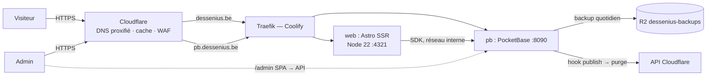

# phant0mhex — System design (v0.1, à valider)

Site vitrine + blog de **Nicolas Dessenius** (Lead dev / Game designer), domaine `dessenius.be`.
Direction artistique : *Industrial Brutalism — Tactical Telemetry* (voir `docs/DESIGN.md`).

---

## 1. Stack retenue

| Couche | Choix | Pourquoi |
|---|---|---|
| Front public | **Astro** (SSR, adapter `@astrojs/node` standalone) | Site orienté contenu : HTML rendu serveur, zéro JS par défaut, îlots seulement là où il y a de l'interaction (3D, motion, admin). Le SSR permet de publier un billet sans rebuild. |
| Îlots interactifs | **React** (îlots Astro) | Admin et composants riches. Écosystème (CodeMirror, TanStack Query). |
| 3D temps réel | **Three.js** + `postprocessing` (pmndrs) | Hero et visuels : shader de *dithering* Bayer 1-bit maison en passe de post-process. Vanilla Three (pas R3F) pour garder les îlots légers et hors React côté public. |
| Assets 3D | **Blender** → glTF/GLB (export headless) → `gltf-transform` (Meshopt + KTX2) | Pipeline scripté et reproductible ; les rendus Cycles servent aussi de *poster* statique (LCP, fallback sans WebGL, `prefers-reduced-motion`). |
| Motion | **GSAP** (ScrollTrigger, SplitText) + **Lenis** + View Transitions d'Astro | Timelines précises, scroll piloté, transitions de page « wipe CRT ». |
| Styles | CSS natif + tokens (`packages/tokens/tokens.css`), CSS Grid, `@layer` | Le système brutaliste repose sur des grilles et bordures exactes ; pas besoin d'un framework utilitaire. |
| Back / CMS | **PocketBase** (Go, SQLite) | Un binaire : auth (MFA), collections, règles d'accès, upload de fichiers + miniatures, hooks JS, backups S3. Versionné dans le repo (migrations + hooks). |
| Markdown | **unified** : remark-gfm, remark-directive, rehype-slug, Shiki, rehype-sanitize | Un seul pipeline (`packages/markdown`) partagé par le site **et** l'aperçu admin → rendu identique. |
| Éditeur admin | **CodeMirror 6** + toolbar maison + upload drag/drop/coller | Markdown source-first, raccourcis clavier, autosave. |
| Qualité | Biome (lint/format), `astro check`/`tsc`, Vitest, Playwright | Outils rapides, un seul linter. |
| Monorepo | pnpm workspaces, Node 22 LTS | |
| Hébergement | **Coolify** (`coolify.fs0ciety.org`, Traefik) — 2 applications Dockerfile | Convention existante sur ce Coolify (build pack Dockerfile, GitHub App). |
| Edge | **Cloudflare** (DNS proxifié, SSL Full strict, Cache Rules, Access, R2, Web Analytics) | Zone `dessenius.be` déjà active. |

Alternatives écartées : **Next.js** (plus lourd côté client pour un site de contenu ; le projet Coolify « Dessenius.be » le mentionnait, à confirmer), **Go pur / templ** (moins confortable pour l'admin riche), **R3F** (inutile hors React), **Strapi/Directus** (plus lourds que PocketBase pour un seul auteur).

---

## 2. Vue d'ensemble



- **web** rend toutes les pages publiques côté serveur en lisant PocketBase (réseau interne Docker, `PB_INTERNAL_URL`).
- **/admin** est une SPA React (îlot `client:only`, `noindex`) qui parle directement à `pb.dessenius.be` via le SDK PocketBase.
- Le dashboard natif PocketBase (`pb.dessenius.be/_/`) est protégé par **Cloudflare Access**.

---

## 3. Structure du repo

```
apps/
  web/                 Astro (pages publiques + /admin)
    src/pages/         routes (voir §5)
    src/islands/       hero3d/, motion/, admin/ (React)
    src/lib/pb.ts      client PocketBase serveur (typé)
    Dockerfile
  pb/                  PocketBase
    pb_migrations/     schéma versionné (JS)
    pb_hooks/          logique serveur (*.pb.js)
    Dockerfile
packages/
  markdown/            pipeline unified partagé (site + aperçu admin)
  tokens/              tokens.css + tokens.ts du design system
  pb-types/            types TS des collections (maintenus à la main, alignés sur les migrations)
assets/3d/             sources .blend (Git LFS) + scripts d'export
docker-compose.yml     dev local (web + pb)
docs/                  ARCHITECTURE.md, DESIGN.md, ADR/
.claude/               agents, skills, commandes du projet
```

---

## 4. Modèle de données (PocketBase)

| Collection | Champs principaux | Règles |
|---|---|---|
| `editors` (auth) | email, name, avatar · MFA OTP **désactivée temporairement** (migration `1792290000`, pas de SMTP) | aucune inscription publique |
| `categories` | name, slug (unique), description, order | lecture publique · écriture éditeurs |
| `tags` | name, slug (unique) | idem |
| `posts` | title, slug (unique), excerpt, body (markdown), cover (file), category → categories, tags → tags[], status (`draft`/`scheduled`/`published`), published_at, reading_time, seo_title, seo_description, featured, revision | lecture publique **seulement** si `status = "published" && published_at <= @now` ; écriture éditeurs |
| `media` | file (image, thumbs `480x0`, `960x0`, `1920x0`), alt (requis), caption, width, height, post → posts | lecture publique · écriture éditeurs |
| `projects` | title, slug, role, year, url, summary, body (md), cover, order, featured | lecture publique · écriture éditeurs |
| `site` (1 ligne) | bio (md), email, socials (json), status_dispo | lecture publique · écriture éditeurs |

Hooks (`apps/pb/pb_hooks`) :
- slug auto (FR → ASCII) si vide, unicité garantie ;
- `reading_time` calculé à chaque sauvegarde ; `revision++` ;
- passage à `published` sans date → `published_at = now` ;
- après publication/modification d'un billet publié → **purge du cache Cloudflare** des URLs concernées (`/`, `/journal`, `/journal/<slug>`, flux RSS) ;
- `media` : lecture des dimensions pour `width`/`height` (anti-CLS).

Billets programmés : la règle `published_at <= @now` les rend visibles automatiquement ; un cron PocketBase (toutes les 5 min) purge le cache quand un billet programmé devient visible.

---

## 5. Routes

| Route | Rendu | Cache edge |
|---|---|---|
| `/` | SSR | `s-maxage=300, stale-while-revalidate=86400` + purge sur publication |
| `/projets`, `/projets/[slug]` | SSR | idem |
| `/journal`, `/journal/[slug]` | SSR | idem |
| `/journal/categorie/[slug]`, `/journal/tag/[slug]` | SSR | idem |
| `/rss.xml`, `/sitemap.xml` | SSR | idem |
| `/og/[slug].png` | SSR (satori + resvg, image OG brutaliste) | 7 j |
| `/admin/*` | SPA React `client:only`, `noindex` | bypass |

Recherche dans le journal : filtre PocketBase (`title ~ q || body ~ q`) via un endpoint Astro, suffisant pour un seul auteur.

---

## 6. Admin (publication)

- **Connexion** : email + mot de passe + OTP (MFA PocketBase). Session = token SDK.
- **Billets** : liste filtrable (statut, catégorie), création, édition, duplication, suppression (corbeille = statut `draft` + archive).
- **Éditeur** : CodeMirror 6, toolbar (H1–H3, gras, italique, barré, code inline/bloc, citation, listes, lien, image, tableau, encart `:::note`/`:::warning`, séparateur, embed vidéo), raccourcis (`Mod-B`, `Mod-I`, `Mod-K`…), modes Écrire / Split / Aperçu avec scroll synchronisé, compteur de mots et temps de lecture.
- **Images** : glisser-déposer, coller, ou bouton → upload dans `media` (alt obligatoire) → insertion ``. Le pipeline Markdown résout `media:<id>` en `` (miniatures PocketBase, `width`/`height`, `loading="lazy"`).
- **Autosave** : brouillon local (localStorage) immédiat + PATCH serveur débouncé (2 s) ; indicateur « enregistré / non enregistré » ; conflit détecté via `revision`.
- **Catégories / tags** : CRUD inline, réordonnancement des catégories.
- **Médiathèque** : grille, recherche, alt/légende éditables, détection des médias non utilisés.
- **Projets** et **Réglages du site** (bio, liens, statut de dispo).

---

## 7. 3D & motion — budget et règles

- Hero : un objet (rendu Blender → GLB ≤ 400 Ko), passe de dithering Bayer 8×8 1-bit (blanc phosphore sur `#0B0B0B`, rouge pour les highlights), parallaxe souris.
- Chargement : poster statique (rendu Cycles tramé) affiché d'abord ; Three.js chargé en `client:visible` puis fondu.
- Rendu uniquement quand visible (IntersectionObserver), pause onglet caché, DPR plafonné à 1.5, 30 fps sur mobile.
- `prefers-reduced-motion` : aucune animation, poster statique, transitions instantanées.
- Budgets : JS public hors 3D ≤ 60 Ko gz ; îlot 3D ≤ 180 Ko gz ; LCP < 2 s (4G) ; CLS < 0.05.

---

## 8. Déploiement

**Coolify** (`coolify.fs0ciety.org`, serveur `localhost` 152.53.176.13, Traefik v3 + Let's Encrypt via challenge DNS Cloudflare) — conventions existantes : build pack Dockerfile, déploiement via la GitHub App déjà installée sur `fs0ciety7000`.

| App Coolify | Source | Domaine | Notes |
|---|---|---|---|
| `dessenius-web` | `apps/web/Dockerfile` | `dessenius.be`, `www.dessenius.be` (→ 301 apex) | Node 22, port 4321, healthcheck `/healthz` |
| `dessenius-pb` | `apps/pb/Dockerfile` | `pb.dessenius.be` | volume persistant `/pb/pb_data`, port 8090 |

- Projet Coolify cible : **« Dessenius.be »** (environnement `production`).
- Auto-déploiement au push sur `main` ; *preview deployments* Coolify possibles sur les PR.
- Secrets dans les variables d'environnement Coolify uniquement (`PB_INTERNAL_URL`, `PUBLIC_PB_URL`, `CF_ZONE_ID`, `CF_PURGE_TOKEN`, identifiants S3 R2…).
- Backups PocketBase : quotidien vers un bucket R2 `dessenius-backups`, rétention 14 j.

**Cloudflare** (zone `dessenius.be`, SSL **Full (strict)**) :
- `A dessenius.be` et `A www` → 152.53.176.13 (existent déjà, proxifiés).
- À créer : `A pb.dessenius.be` → 152.53.176.13 (proxifié).
- Cache Rule : mettre en cache le HTML de `dessenius.be/*` hors `/admin*` (respecte `s-maxage`).
- Durcissement proposé : *Always Use HTTPS* activé, TLS min 1.2.
- Cloudflare Access sur `pb.dessenius.be/_` et `/api/collections/_superusers` (en place).
- Ne pas toucher aux enregistrements mail (MX, SPF, DKIM, DMARC) ni à `mariage`, `elodie`, `grace`, `wedding`.


---

## 9. Qualité & CI

- GitHub Actions : `pnpm lint` (Biome) → `pnpm typecheck` → `pnpm test` (Vitest) → `pnpm e2e` (Playwright contre `docker compose`) → build des 2 images.
- Lighthouse CI sur `/` et `/journal/<slug>` avec les budgets du §7.
- Le déploiement Coolify se déclenche au push sur `main` (la CI doit être verte avant merge).

---

## 10. Décisions (validées le 2026-10-18)

1. **Domaine** : l'ancienne app sur `dessenius.be` est supprimée → ce projet prend `dessenius.be` et `www`.
2. **PocketBase** : l'image versionnée de ce repo remplace le service PocketBase existant du projet Coolify « Dessenius.be » (supprimé une fois le nouveau en ligne).
3. **Astro** validé (pas Next.js).
4. **Corps des billets** : monospace par défaut, avec une bascule lecteur « sans-serif » (IBM Plex Sans), mémorisée dans le navigateur.
5. **Contact** : simple lien `mailto:` (pas de formulaire).
6. **Langue** : français uniquement.
7. **Contenu** (bio, projets, liens, e-mail) : fourni plus tard ; placeholders `[…]` en attendant, éditables depuis l'admin (`site`, `projects`).
